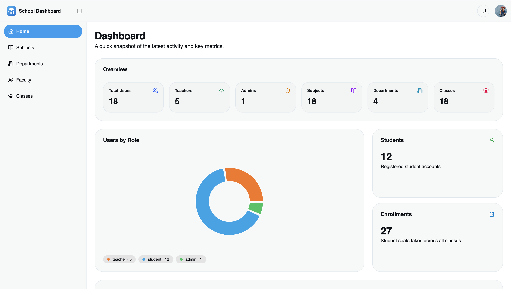
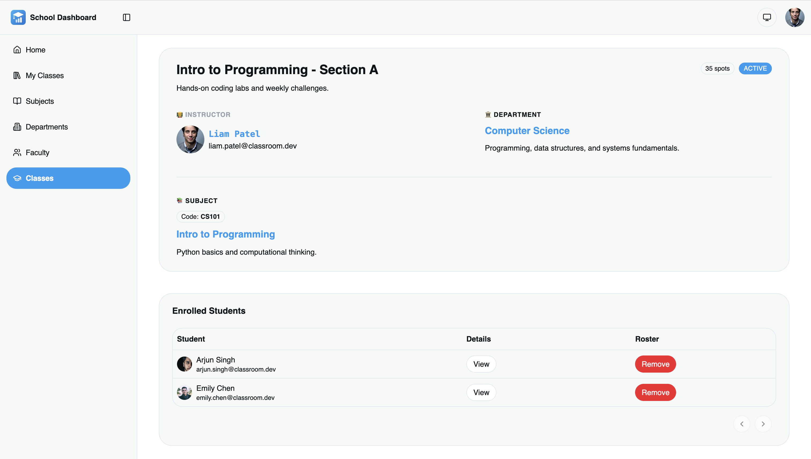
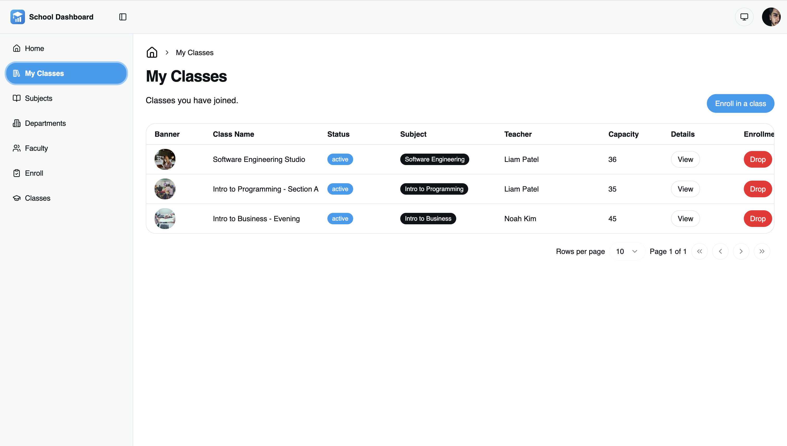
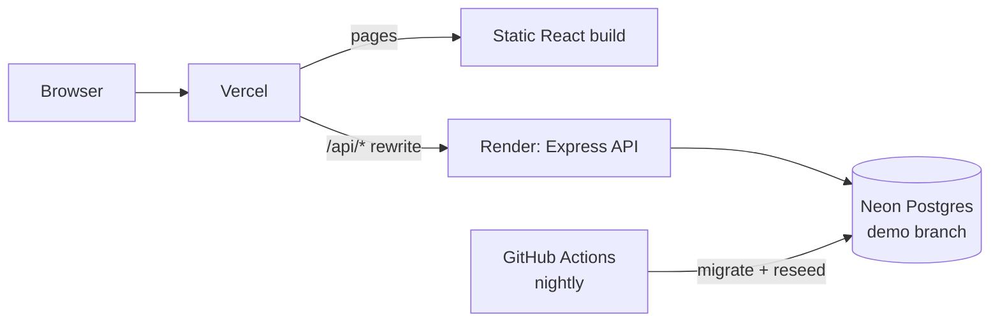

# School Dashboard: University Management App

[](https://github.com/lichangcodes/school-dashboard/actions/workflows/ci.yml)

A full-stack app for running a university's academic structure: departments, subjects, classes, faculty and enrollments. It has three roles (admin, teacher, student), and the server enforces each role's permissions.

**Live demo: [school-dashboard-beige-two.vercel.app](https://school-dashboard-beige-two.vercel.app)**. On the login page, click **Admin**, **Teacher** or **Student** to sign in with a demo account. The demo database is reset every night, so feel free to change anything. The first request after a quiet period can take up to a minute while the free backend instance wakes up.



<table>
  <tr>
    <td></td>
    <td></td>
  </tr>
  <tr>
    <td align="center">Class details, teacher view</td>
    <td align="center">My Classes, student view</td>
  </tr>
</table>

**Stack:** TypeScript · React 19 · Refine · Tailwind CSS · shadcn/ui · Node.js · Express 5 · PostgreSQL (Neon) · Drizzle ORM · Better Auth · Vitest · GitHub Actions · Vercel · Render

## Features

- **Dashboard** with headline counts, recent activity, and charts of users by role, subjects per department and classes per subject
- **Departments → subjects → classes**, each with list, detail, create and edit pages
- **Classes** with an assigned teacher, a capacity, a weekly schedule, a banner image (uploaded to Cloudinary) and a status: active, inactive or archived
- **Enrollment**: students join classes and can drop them; teachers can remove students from their own classes
- **My Classes**: a teacher sees the classes they teach, and a student sees the classes they're enrolled in
- **Server-side search, filtering and pagination** on every list
- **Email/password auth** with cookie sessions, plus light and dark themes

## Permissions

The backend enforces every rule below. The frontend only uses them to hide actions a user can't take.

| Action | Admin | Teacher | Student |
| --- | :-: | :-: | :-: |
| View departments, subjects, classes, faculty | ✅ | ✅ | ✅ |
| Create, edit or delete departments and subjects | ✅ | | |
| Create classes | ✅ any teacher | ✅ own only | |
| Edit or archive classes | ✅ | ✅ own only, can't reassign | |
| Hard-delete a class (only if no one is enrolled) | ✅ | | |
| Enroll in a class | | | ✅ self only |
| Remove a student from a class | ✅ | ✅ own classes | ✅ drop self |

A few more rules:

- Only **active** classes accept enrollments. A class can't be over capacity, and its capacity can't be lowered below its current enrollment.
- Users can sign up as a teacher or student, never as an admin. No one can change their own role.
- When a teacher asks for another teacher's class, the API returns **404**, not 403, so teachers can't find out which class IDs exist.

## Engineering highlights

### Enrollment that holds up under concurrent requests

The first version checked capacity and duplicates with a `SELECT`, then ran an `INSERT`. Under concurrent requests, two students could both see the last free seat, and a double-submit could enroll the same student twice. A test that sends 5 enrollments at once reproduced both problems: all 5 students got into a 1-seat class.

The fix ([`routes/enrollments.ts`](backend/src/routes/enrollments.ts)):

- **Duplicates:** a unique constraint on `(student_id, class_id)`. The database rejects the second insert, and the API turns that into a 409.
- **Capacity:** enrollment runs in a transaction that first locks the class row (`SELECT ... FOR UPDATE`), so requests for the same class wait their turn. It counts seats in a separate statement after it gets the lock. Under Postgres's default READ COMMITTED isolation, a single statement counts from a snapshot taken when the statement started, so it could miss students enrolled while it waited.
- **Capacity changes:** `PATCH /classes/:id` takes the same lock, so lowering capacity can't race a new enrollment.

### Dashboard numbers computed in the database

The dashboard used to download users, subjects and classes and count them in the browser. The request sent no page size, so the API returned its default page of 10 rows, and every count and chart stopped at 10. The demo actually has 18 users, 18 subjects and 18 classes. The dashboard now calls `/api/stats/*` endpoints that aggregate with `count(*)` and `GROUP BY` in Postgres. That fixes the numbers and means only a few totals cross the network, however much data there is. Postgres returns `count(*)` as a `bigint`, which the driver turns into a string, so the queries cast it to `int`, and a test checks that the API returns real numbers.

### Integration tests and CI

There are 35 backend integration tests in [`backend/tests/`](backend/tests), written with Vitest and Supertest. They cover the concurrency cases above, every rule in the permissions table (testing both what each role can do and what it can't), and the dashboard statistics. They call the real Express app in-process and run against a separate Neon branch that is migrated and wiped before each run. A guard refuses to run them if they point at the development database.

[GitHub Actions](.github/workflows/ci.yml) runs a typecheck and the tests on the backend, and lint and a build on the frontend, for every pull request.

### Deployment



- **Same-origin API.** Vercel forwards `/api/*` to the backend, so the browser sees a single site. The session cookie stays first-party (`HttpOnly`, `Secure`, `SameSite=Lax`) and isn't blocked like a third-party cookie would be, for example by Safari.
- **A demo you can safely share.** The demo accounts are public, so Better Auth's change-password and update-profile endpoints are turned off, and a [nightly workflow](.github/workflows/reset-demo.yml) reloads the seed data.

## API overview

All routes require a session except `/api/auth/*`. List endpoints take `search`, `page` and `limit`, and return `{ data, pagination }`. Errors return `{ error }`.

| Resource | Endpoints |
| --- | --- |
| Auth | `/api/auth/*` (Better Auth: sign-up, sign-in, sign-out, session) |
| Departments | `GET /api/departments`, `POST`, `GET/PATCH/DELETE /:id`, `GET /:id/{subjects,classes,users}` |
| Subjects | `GET /api/subjects`, `POST`, `GET/PATCH/DELETE /:id`, `GET /:id/{classes,users}` |
| Classes | `GET /api/classes` (`status=active\|inactive\|archived\|all`), `GET /mine`, `POST`, `GET/PATCH/DELETE /:id`, `GET /:id/users`, `DELETE /:id/students/:studentId` |
| Enrollments | `POST /api/enrollments` |
| Users | `GET /api/users`, `GET /:id`, `GET /:id/{departments,subjects}` |
| Stats | `GET /api/stats/{overview,latest,charts}` |

## Running locally

**Prerequisites:** Node.js 22+, a PostgreSQL database (a free [Neon](https://neon.tech) project works), and a Cloudinary account if you want image uploads.

### Backend

```bash
cd backend
npm install
cp .env.example .env      # set DATABASE_URL, BETTER_AUTH_SECRET, FRONTEND_URL
npm run db:migrate
npm run db:seed           # optional; deletes all rows, then loads sample data
npm run dev               # http://localhost:8000
```

### Frontend

```bash
cd frontend
npm install
cp .env.example .env      # VITE_BACKEND_BASE_URL=http://localhost:8000/api/ and Cloudinary settings
npm run dev               # http://localhost:5173
```

After seeding, the demo buttons on the login page work locally too. The accounts are listed in [`backend/seed/data.json`](backend/seed/data.json).

### Tests

The tests need a separate, disposable database, because they wipe every table.

```bash
cd backend
cp .env.test.example .env.test   # DATABASE_URL of a separate Neon branch
npm test
```

## Project structure

```
backend/
  src/app.ts            Express app: middleware and routers
  src/routes/           One router per resource, with hand-written Drizzle queries
  src/middleware/       requireAuth / requireRole
  src/lib/              Better Auth config, zod request schemas, Postgres error mapping
  src/db/schema/        Drizzle schema
  drizzle/              SQL migrations
  tests/                Vitest + Supertest integration tests
frontend/
  src/pages/<resource>/ list, show, create and edit pages
  src/providers/        Refine data, auth and access-control providers
  vercel.json           SPA fallback and the /api proxy
```

## Known limitations

- The free Render instance sleeps when idle, so the first request can be slow.
- The frontend has no automated tests. Lint and build run in CI.
- Hard-deleting an empty class doesn't take the class row lock, so it can still race an enrollment that arrives at the same moment. Only admins can delete classes, and only empty ones.
